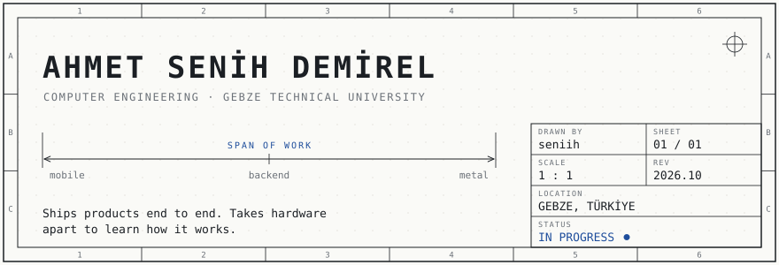
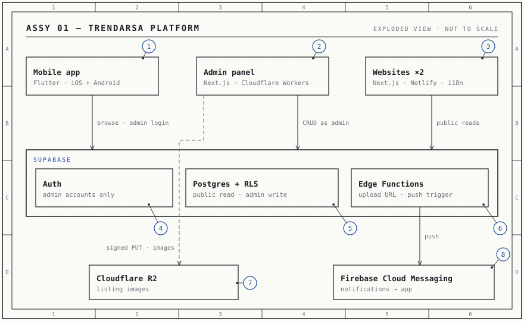

<picture>
  <source media="(prefers-color-scheme: dark)" srcset="assets/title-block-dark.svg">
  
</picture>

I study computer engineering at Gebze Technical University and spend most of my time building software people actually use. For a real estate company I built the whole thing: the mobile app, the admin panel, two websites, and the accounting system that tracks every plot from purchase to payout.

The rest of my time goes one layer down, into C, embedded systems and security.

&nbsp;

### Bill of materials

| ID | Part | Function | Spec |
|:--:|------|----------|------|
| 01 | TrendArsa platform<br><sub>[app](https://github.com/seniih/trendarsa-app) · [admin](https://github.com/seniih/trendarsa-admin) · [web](https://github.com/seniih/trendarsa-web) · [trendev](https://github.com/seniih/trendev-web)</sub> | Listings app, admin panel and two sites for a real estate company | Flutter · Next.js · Supabase · R2 · FCM |
| 02 | [TrendArsa Ledger](https://github.com/seniih/finance-tracker-app) | Double-entry accounting for land investment: projects, investors, sales, payouts | Flutter · Postgres triggers + RPC · RLS |
| 03 | Fısıldio | A social network for GTU students. Private while in development. | Flutter |
| 04 | [StockTracker](https://github.com/seniih/stock-tracker-bot) | Telegram bot that tells you when your size is back in stock at Zara or DeFacto | Python · SQLite |

<sub>**NOTES**<br>
1. Ledger: each transaction writes balanced debit/credit lines in a single Postgres transaction. Investor payouts are computed by triggers, and the app has no write access to that table.<br>
2. StockTracker sends one message per restock, not one per check.</sub>

&nbsp;

### Assembly

<picture>
  <source media="(prefers-color-scheme: dark)" srcset="assets/assembly-dark.svg">
  
</picture>

| Item | Part | Role |
|:----:|------|------|
| 1 | Mobile app | Visitors browse active listings without an account; admins sign in to post |
| 2 | Admin panel | Manages listings, projects and the content shown on the websites |
| 3 | Websites ×2 | Public, multilingual sites for TrendArsa and TrendEv; read-only |
| 4 | Auth | Accounts exist only for admins, so visitors never need to sign up |
| 5 | Postgres + RLS | Policies let anyone read active listings and only admins write, enforced in the database by `is_admin()` |
| 6 | Edge Functions | `generate-upload-url` signs image uploads, `notify-new-listing` triggers the push |
| 7 | Cloudflare R2 | Listing and project images, uploaded straight from the browser |
| 8 | Firebase Cloud Messaging | Notifies app users when a new listing goes live |

<sub>The dashed line is a hidden line: an Edge Function signs the upload, then the browser sends the image straight to R2 without passing through the database.</sub>

&nbsp;

### On the bench

```
EMBEDDED    microcontrollers in C, one lesson at a time
SECURITY    15-module self-study: networks → web → pentest → forensics
C / C++     coursework and small systems programs
```

### Toolkit

Dart / Flutter · TypeScript / Next.js · Python · C / C++ · PostgreSQL / Supabase · Cloudflare · Firebase

&nbsp;

---

<sub>**CONTACT** &nbsp; [a.senihdemirel@icloud.com](mailto:a.senihdemirel@icloud.com) · [LinkedIn](https://www.linkedin.com/in/senihdemirel/) &nbsp;&nbsp;|&nbsp;&nbsp; **REV A** &nbsp; 2026-10 &nbsp; first issue</sub>
